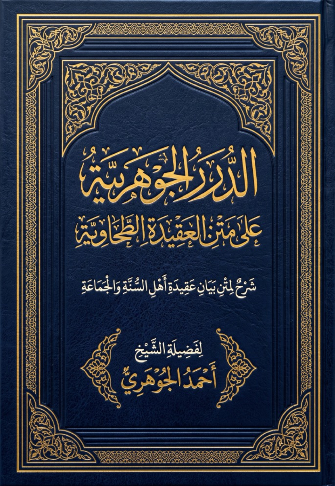
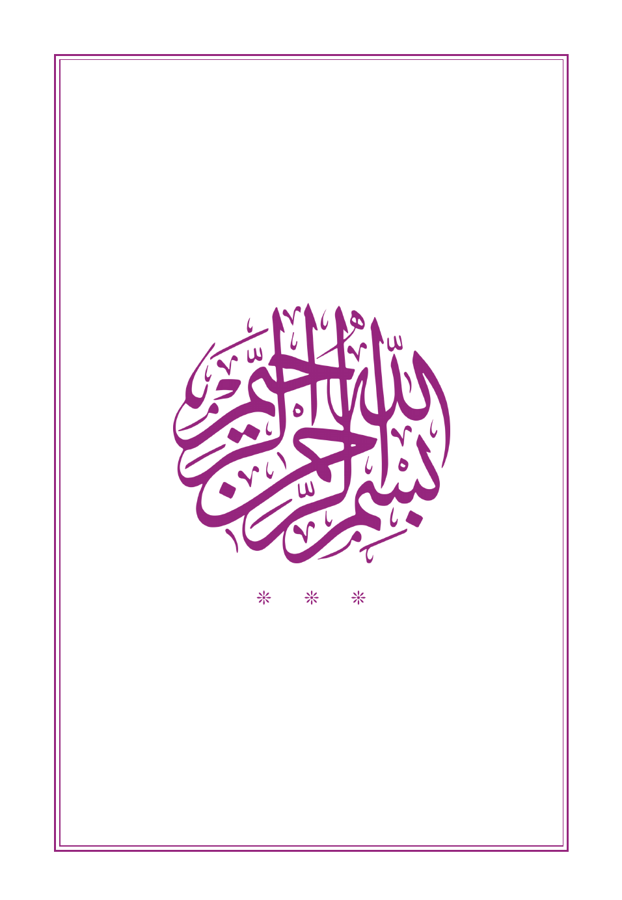
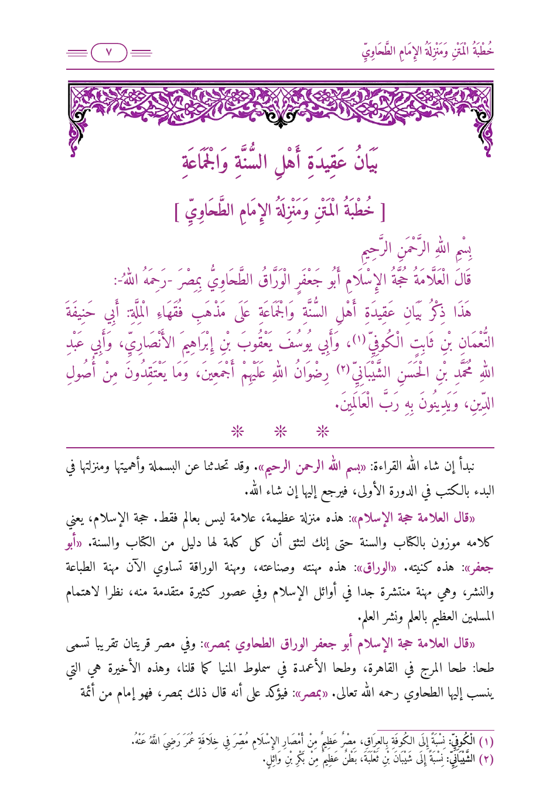
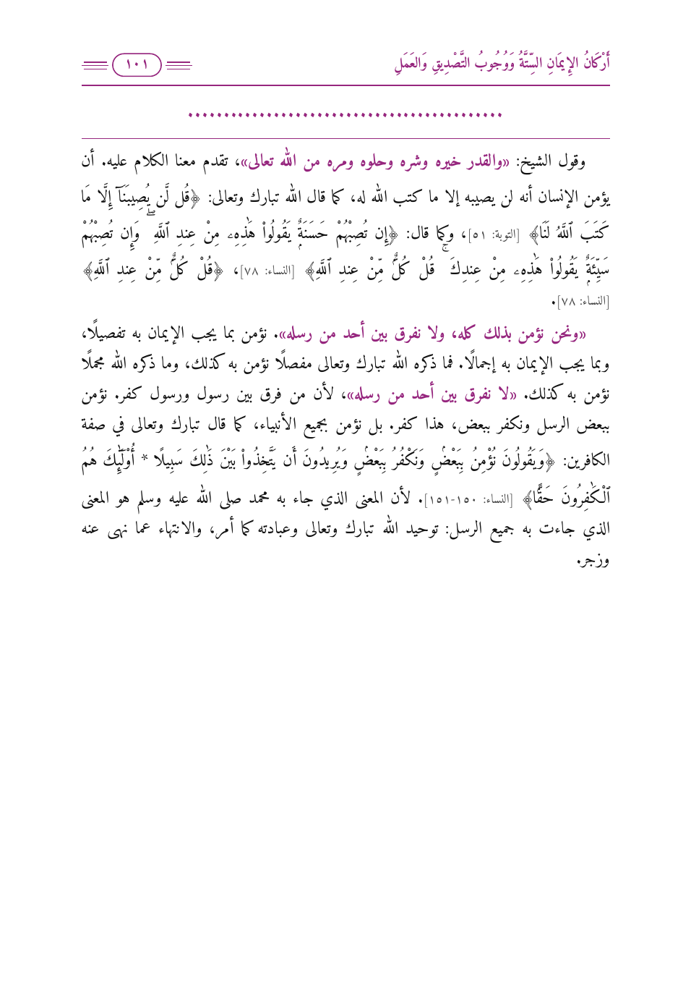

# الدُّرَرُ الجَوْهَرِيَّةُ عَلَى مَتْنِ العَقِيدَةِ الطَّحَاوِيَّةِ
### شَرْحُ مَتْنِ بَيَانِ عَقِيدَةِ أَهْلِ السُّنَّةِ وَالْجَمَاعَةِ — لِفَضِيلَةِ الشَّيْخِ أَحْمَدَ الْجَوْهَرِيِّ عَبْدِ الْجَوَادِ

  
  
  
  

---

## بطاقة الكتاب والمنهج

- **المَتْنُ:** بَيَانُ عَقِيدَةِ أَهْلِ السُّنَّةِ وَالْجَمَاعَةِ (العَقِيدَةُ الطَّحَاوِيَّةُ)، للإمام أبي جعفر أحمد بن محمد بن سلامة الطحاوي الأزدي المصري (٢٣٩ – ٣٢١ هـ)، مضبوطاً بالشكل الكامل وَفق المصادر المعتمدة لمتن الطحاوية (١٢٢ سطراً متنياً محققاً عبر «ملتقى الإسناد»).
- **الشَّارِحُ:** لِفَضِيلَةِ الشَّيْخِ **أَحْمَدَ الْجَوْهَرِيِّ عَبْدِ الْجَوَادِ** (حَفِظَهُ اللَّهُ تَعَالَى وَنَفَعَ بِعِلْمِهِ).
- **المَصْدَرُ الصَّوْتِيُّ:** السلسلة الصوتية الكاملة لشرح متن العقيدة الطحاوية على يوتيوب — [**قائمة التشغيل الكاملة (٧ لقاءات — ٤١١ دقيقة)**](https://youtube.com/playlist?list=PLjR2AWKLjP8Rdz2-PlbLAiwpzwLyOzlzI).
- **المُرَاجَعَةُ الصَّوْتِيَّةُ وَالتَّحْقِيقُ:** تفريغٌ ومراجعةٌ سمعيةٌ مباشرةٌ لكامل السلسلة عبر **٦٢ مقطعاً صوتياً** (بنسبة مطابقة `٩٩٫٩٪–١٠٠٪` لكلمات التفريغ الحرفي الخام، وضبط الآيات القرآنية كافةً **بالرسم العثماني للمصحف الشريف** بخط `Amiri Quran` مع عزو موضع كل آية `[السورة: الآية]` بخط أصغر بجانبها).
- **المَقَاسُ وَالطِّبَاعَةُ:** القطع التراثي القياسي (**١٦٢ × ٢٣٤ ملم**) بإخراج مطبعي تراثي باللونين **الأرجواني البرقوقي (`#96267e`) والأسود الفحمي (`#111111`) على ورق أبيض** (مع نسخة كلاسيكية أحادية اللون متطابقة في الصفحات والأسطر 1:1 تماماً):
  - **لوحة البسملة الخطية:** بسملة خطية مفرغة مرسومة بعناية في صفحة الصدارة الرابعة (`ص ٤`).
  - **الأفاريز التراثية المخرَّمة والنجمات الثلاث:** أفريز عربي أرجواني وأسود متدلي الجوانب على رءوس الفصول والفهارس والمقدمة (ونسخته الأحادية الموزونة للطبعة الكلاسيكية)، وفواصل ثلاث نجمات زخرفية ثمانية البتلات متجاورة أسفل البسملة وفي ختام المتن والكتاب.
  - **الترويسة المتناوبة وشارة الترقيم المجنَّحة:** خط سفلي ممتد عبر الصفحة، مع رقم الصفحة داخل إطار مزدوج مجنَّح `═══ (٥) ═══` في الجانب الداخلي المتناوب (يميناً في الصفحات الزوجية مع عنوان الكتاب يساراً، ويساراً في الصفحات الفردية مع عنوان الباب يميناً)، مع منع تآكل التشكيل العلوي (الشدة والفتحة) في شريط الترويسة العلوي ورءوس الأبواب.
  - **فصل المتن عن الشرح:** المتن مشكولاً أعلى الصفحة يليه خط فاصل والشرح أسفله، مع نقاط الاستمرار `............................................` ومنع تداخل الشرح مع الحاشية.

---

## نُسَخُ الكِتَابِ المُتَوَفِّرَةُ (PDF • DOCX • Markdown • HTML • Google Docs)

### ١. النُّسْخَةُ الحَرْفِيَّةُ الكَامِلَةُ (`Verbatim Edition` — **١٦٢ صفحة** | **٣٢,٣٥٧ كلمة شرح + ٢,١٩٧ كلمة متن**)
تُثْبِتُ كلامَ الشيخ الشارح كاملاً كما أُلقي في المجالس الصوتية السبعة دون حذف أو اختصار، مقسَّمةً إلى **٦٩ وحدةً علميةً** بالآيات العثمانية وعزوها السُّوري:
- [**PDF النسخة الملوَّنة (أرجواني #96267e وأسود على أبيض — ١٦٢ ص)**](الدُّررُ_الجوهرية_على_متن_العقيدة_الطحاوية/الدُّررُ_الجوهرية_على_متن_العقيدة_الطحاوية_نسخة_لونين.pdf)
- [**PDF النسخة الكلاسيكية (أبيض وأسود — ١٦٢ ص)**](الدُّررُ_الجوهرية_على_متن_العقيدة_الطحاوية/الدُّررُ_الجوهرية_على_متن_العقيدة_الطحاوية.pdf)
- [**Word DOCX الملوَّن القابل للتعديل (١٦٢ × ٢٣٤ ملم)**](الدُّررُ_الجوهرية_على_متن_العقيدة_الطحاوية/الدُّررُ_الجوهرية_على_متن_العقيدة_الطحاوية_نسخة_لونين.docx)
- [**Word DOCX الكلاسيكي القابل للتعديل (١٦٢ × ٢٣٤ ملم)**](الدُّررُ_الجوهرية_على_متن_العقيدة_الطحاوية/الدُّررُ_الجوهرية_على_متن_العقيدة_الطحاوية.docx)
- [**المجلد الكامل بصيغة Markdown**](الدُّررُ_الجوهرية_على_متن_العقيدة_الطحاوية/الدُّررُ_الجوهرية_على_متن_العقيدة_الطحاوية.md) | [**العارض التفاعلي HTML**](viewer/index.html)
- [**مستند Google Docs المنسق — النسخة الحرفية الكاملة**](https://docs.google.com/document/d/147BU4-ktK9Kkt9xrUYEkwJBTK3_2JNjUdJMdjFjOK-M/edit)
- [**التفريغ الحرفي الخام المجرد كما ذُكر (TXT)**](تفريغ_كامل_مجرد_كما_ذكر/الدُّررُ_الجوهرية_على_متن_العقيدة_الطحاوية_تفريغ_كامل_مجرد.txt)

### ٢. النُّسْخَةُ المُحَرَّرَةُ المُنَقَّاةُ بِأَلْفَاظِ الشَّيْخِ (`Edited Edition` — **١٥٨ صفحة** | **٣١,٥٩٧ كلمة شرح + ٢,١٩٧ كلمة متن**)
تفريغٌ مُحَرَّرٌ لمحاضرات الشيخ في شرح متن العقيدة الطحاوية؛ بُنِيَت على **حفظ ألفاظ الشيخ وعباراته حرفياً دون إبدالٍ أو اختصارٍ أو تلخيص** (نسبة احتفاظ **٩٧٫٦٥٪** من ألفاظ الشرح)، مع الاقتصار على:
- إبقاء **افتتاحية اللقاء الأول** و**دعاء خاتمة اللقاء السابع** وحذف التحايا والمقدمات والخواتيم المكررة في بقية المقاطع.
- تهذيب التلعثمات والجمل المكررة المتجاورة لفظاً ومعنىً دون المساس بأي لفظٍ أصيل للشارح.
- ضبط الآيات القرآنية كاملةً بالرسم العثماني مع `[السورة: الآية]` بخط أصغر بجانبها:
- [**PDF النسخة المحررة الملوَّنة (أرجواني #96267e وأسود — ١٥٨ ص)**](الدُّررُ_الجوهرية_على_متن_العقيدة_الطحاوية_النسخة_المحررة/الدُّررُ_الجوهرية_على_متن_العقيدة_الطحاوية_النسخة_المحررة_نسخة_لونين.pdf)
- [**PDF النسخة المحررة الكلاسيكية (أبيض وأسود — ١٥٨ ص)**](الدُّررُ_الجوهرية_على_متن_العقيدة_الطحاوية_النسخة_المحررة/الدُّررُ_الجوهرية_على_متن_العقيدة_الطحاوية_النسخة_المحررة.pdf)
- [**Word DOCX المحرر الملوَّن القابل للتعديل (١٦٢ × ٢٣٤ ملم)**](الدُّررُ_الجوهرية_على_متن_العقيدة_الطحاوية_النسخة_المحررة/الدُّررُ_الجوهرية_على_متن_العقيدة_الطحاوية_النسخة_المحررة_نسخة_لونين.docx)
- [**Word DOCX المحرر الكلاسيكي القابل للتعديل (١٦٢ × ٢٣٤ ملم)**](الدُّررُ_الجوهرية_على_متن_العقيدة_الطحاوية_النسخة_المحررة/الدُّررُ_الجوهرية_على_متن_العقيدة_الطحاوية_النسخة_المحررة.docx)
- [**المجلد المحرر الكامل بصيغة Markdown**](الدُّررُ_الجوهرية_على_متن_العقيدة_الطحاوية_النسخة_المحررة/الدُّررُ_الجوهرية_على_متن_العقيدة_الطحاوية_النسخة_المحررة.md) | [**العارض التفاعلي HTML (المحررة)**](viewer/index_edited.html)
- [**مستند Google Docs المنسق — النسخة المحررة**](https://docs.google.com/document/d/1NoKaHFfIFj69x-MXYPU0YTjJndd8C2y9ABUHv6-61d0/edit)

---

## جَدْوَلُ اللِّقَاءَاتِ الصَّوْتِيَّةِ السَّبْعَةِ وَالمُقَارَنَةُ الإِحْصَائِيَّةُ

| اللقاء | الموضوع الرئيس والمباحث | المدة | الوحدات | الحرفية (كلمة شرح) | المحررة (كلمة شرح) | المتن (كلمة) | الرابط الصوتي |
| :---: | :--- | :---: | :---: | :---: | :---: | :---: | :---: |
| **١** | مقدمة الكتاب، وترجمة الإمام الطحاوي، وباب التوحيد والخلق والتقدير | ٥٣ د | ١٠ | ٣,٨٥٨ | ٣,٧٨٦ | ٢٤٥ | [YouTube](https://www.youtube.com/watch?v=drq6oBQPIp4) |
| **٢** | نفوذ المشيئة، ونبوة محمد ﷺ، والقرآن كلام الله، ونفي التشبيه | ٤٨ د | ٩ | ٣,٨٢٦ | ٣,٦٨٨ | ١٩٠ | [YouTube](https://www.youtube.com/watch?v=t8vA8GAlZGQ) |
| **٣** | رؤية المؤمنين لربهم، ولزوم التسليم، والتنزيه، والمعراج، والحوض، ومقدمة الشفاعة | ٥٧ د | ٩ | ٤,٥٧٤ | ٤,٤٧٧ | ٢٦١ | [YouTube](https://www.youtube.com/watch?v=FHexnru62HU) |
| **٤** | الشفاعة، والميثاق الأول، وسر القدر، واللوح والقلم | ٦٤ د | ٩ | ٥,٣٨١ | ٥,٢٣٦ | ٣٣٦ | [YouTube](https://www.youtube.com/watch?v=RhnMTbxEJb0) |
| **٥** | العرش والكرسي، والملائكة والأنبياء والكتب، وأحكام أهل الكبائر، وحقيقة الإيمان | ٦١ د | ١٠ | ٤,٦٣٠ | ٤,٥٢٠ | ٢٢١ | [YouTube](https://www.youtube.com/watch?v=rKrkyKZgvDM) |
| **٦** | أركان الإيمان، والصلاة خلف الأئمة ولزوم الجماعة، وعذاب القبر، والبعث، والاستطاعة | ٦٦ د | ١١ | ٥,١٦٢ | ٥,٠٥٧ | ٥٤١ | [YouTube](https://www.youtube.com/watch?v=VjjI5UwOCk0) |
| **٧** | الدعاء للأموات، وفضل الصحابة والأولياء، وأشراط الساعة، ووسطية الإسلام وخاتمة المتن | ٦٢ د | ١١ | ٤,٩٢٦ | ٤,٨٣٣ | ٤٠٣ | [YouTube](https://www.youtube.com/watch?v=JD9hr3hslUw) |
| **المجموع** | **السلسلة الكاملة (٦٢ مقطعاً صوتياً مراجعاً بالكامل)** | **٤١١ د** | **٦٩** | **٣٢,٣٥٧** | **٣١,٥٩٧** | **٢,١٩٧** | [**قائمة التشغيل**](https://youtube.com/playlist?list=PLjR2AWKLjP8Rdz2-PlbLAiwpzwLyOzlzI) |

---

## خَصَائِصُ الإِخْرَاجِ الفَنِّيِّ وَالتَّوْثِيقِ العِلْمِيِّ

1. **فَصْلُ المَتْنِ عَنِ الشَّرْحِ وَوَحْدَةُ الصَّفْحَةِ:** يظهر المتنُ مضبوطاً بالشكل الكامل أعلى الصفحة (تمت مراجعة وتشكيل جميع السطور المتنية البالغ عددها ١٢٢ سطراً وفق طبعة معتمدة لمتن الطحاوية)، يليه الشرحُ أسفل خطٍّ فاصلٍ أفقي. وعند امتداد الشرح على أكثر من صفحةٍ تظهر نقاط الاستمرار (`............................................`) مكان المتن دون تكرارٍ أو تداخلٍ بين الوحدات.
2. **الآيَاتُ بِالرَّسْمِ العُثْمَانِيِّ وَعَزْوُهَا السُّورِيُّ:** كُتِبَتْ كلُّ آيةٍ قرآنيةٍ في المتن والشرح بخط `Amiri Quran` بالرسم العثماني للمصحف الشريف، يتلوها مباشرةً موضعُها (`[السورة: الآية]`) بخط أصغر غير قابل للانقسام عبر السطور.
3. **الحَوَاشِي المُسْتَقِلَّةُ لِغَرِيبِ الأَلْفَاظِ:** أُلحِقَتْ بالكتاب **٣٦ حاشيةً محقَّقةً** موزَّعةً على **٢٧ موضعاً** في المتن بترقيمٍ جديدٍ يبدأ من `(١)` في كل صفحةٍ مستقلة دون تكرارٍ للمعنى في الصفحة الواحدة، مستفادةً من شروح الطحاوية ومعاجم الغريب والتعريفات (**ابن أبي العز، البياضي، لسان العرب، مفردات الراغب**).
4. **الفَهَارِسُ الكَامِلَةُ:** يحتوي كل كتاب على **فهرسٍ شاملٍ للآيات القرآنية** بالرسم العثماني وموضع السورة والآية وأرقام الصفحات (`٢٦٢` موضعاً في الحرفية، `٢٦٠` في المحررة)، و**فهرسٍ عامٍّ** بعمودين لجميع موضوعات المتن البالغ عددها **٦٩ موضوعاً**.
5. **تَطَابُقُ النُّسْخَةِ الحَرْفِيَّةِ وَالمُلَوَّنَةِ وَملفات DOCX:** يتطابق ترقيم الصفحات وتوزيع السطور بالملي تماماً بين النسخة الكلاسيكية (`#111111`) والنسخة ذات اللونين (`#96267e` + `#111111`)، وكذلك في ملفات `.docx` المبنية برمجياً عبر تحليل شجرة DOM الفعلية وختمها بخصائص OOXML كاملةً (`w:pgSz 9184×13266` twips + لوحة البسملة + الرأس المتناوب و`STYLEREF` + `bidi` RTL + روابط داخلية تفاعلية).

---

## الوَثَائِقُ التَّفْصِيلِيَّةُ لِلمَشْرُوعِ

- [**الملخص التنفيذي والتقارير الإحصائية (`docs/SUMMARY.md`)**](docs/SUMMARY.md): مقارنة شاملة بين النسختين، عينات مرئية من الصفحات، وتفاصيل الفهارس والحواشي والتصحيحات الصوتية.
- [**دليل الخطوات والمنهجية الكاملة (`docs/WORKFLOW_AND_STEPS.md`)**](docs/WORKFLOW_AND_STEPS.md): توثيق تقني وعلمي مفصل لكل مرحلة من مراحل العمل (من السحب الصوتي وتقطيع الـ ٦٢ مقطعاً إلى ضبط المتن والمصحف العثماني والزخارف التراثية وإخراج الكتب والنشر السحابي).
