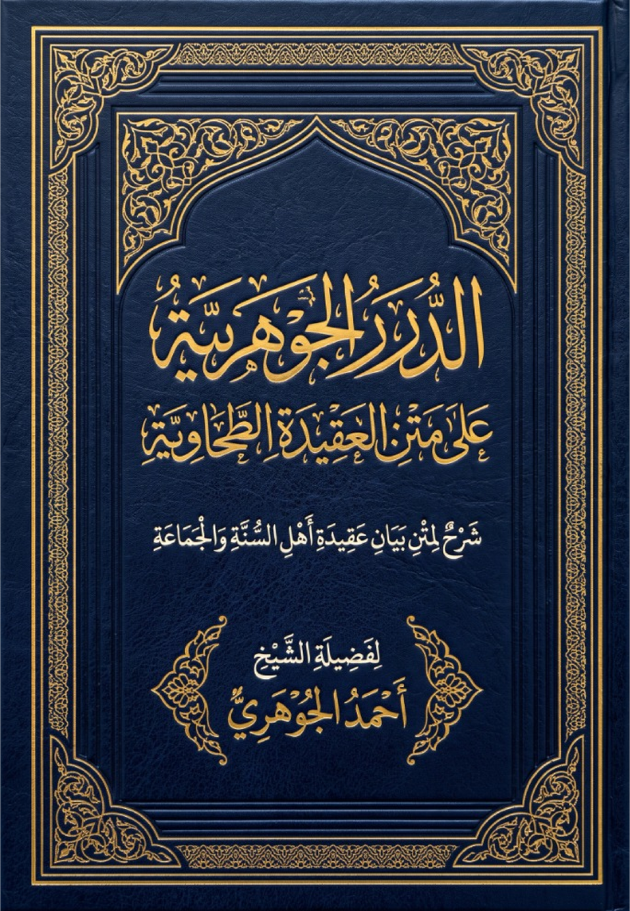
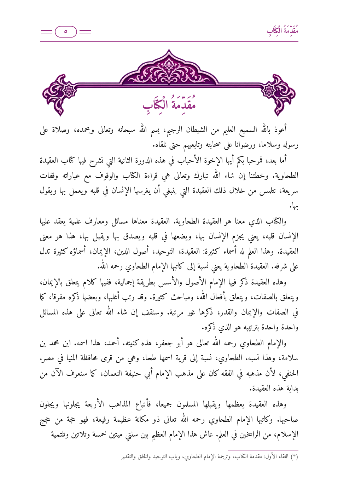
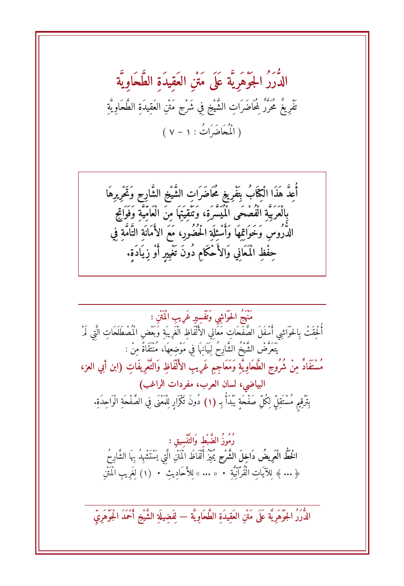
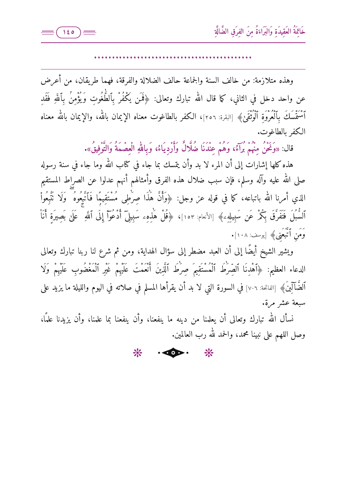
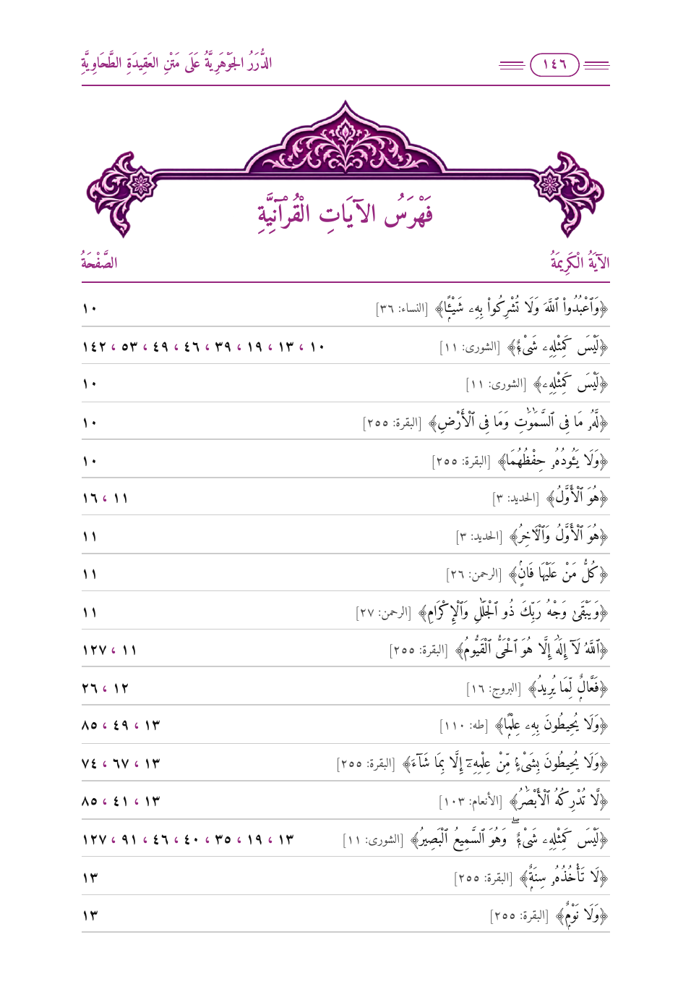
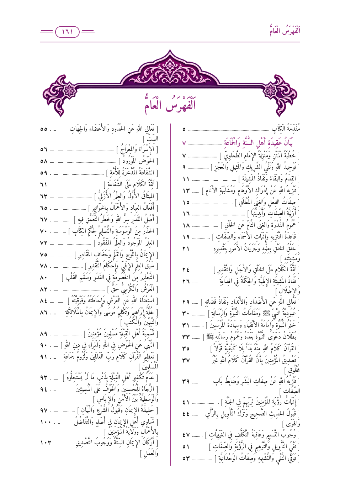
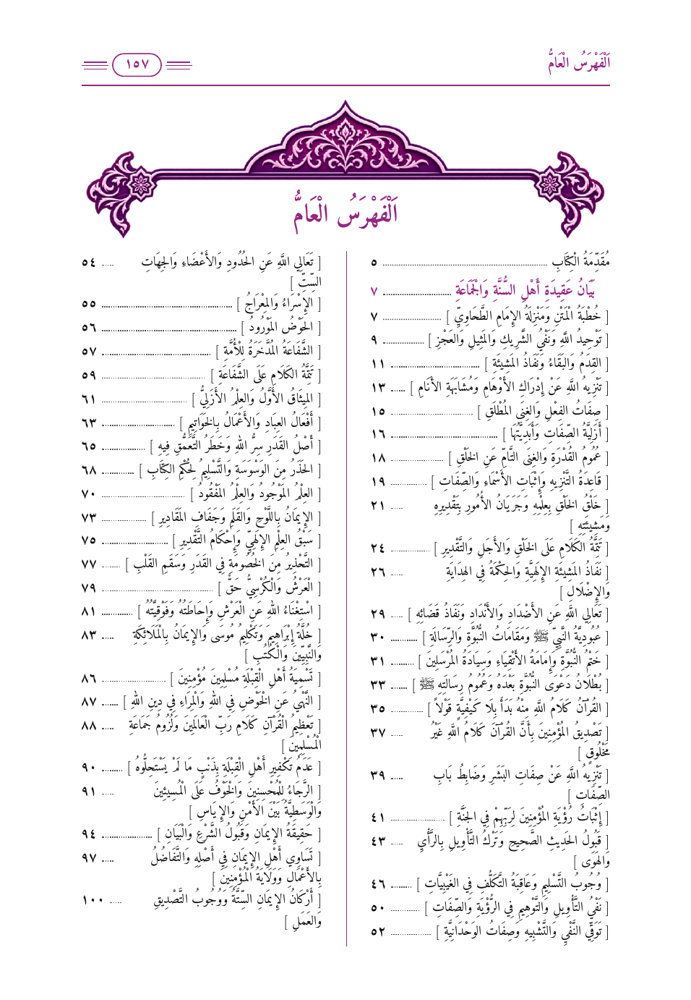

# التقرير الإحصائي والعلمي الشامل — «الدُّرَرُ الجَوْهَرِيَّةُ عَلَى مَتْنِ العَقِيدَةِ الطَّحَاوِيَّةِ» (`v3.0.0`)

## ١. نظرة عامة ونطاق العمل

يمثل هذا المشروع تفريغاً صوتياً مُحَقَّقاً، وإخراجاً مطبعياً متكاملاً على نمط كتب التراث الإسلامي الملوَّنة، لشرح فضيلة الشيخ **أحمد الجوهري عبد الجواد** (حفظه الله تعالى) على متن **«العقيدة الطحاوية — بيان عقيدة أهل السنة والجماعة»** للإمام أبي جعفر الطحاوي (٢٣٩ – ٣٢١ هـ).

- **عدد المجالس الصوتية:** ٧ لقاءات كاملة.
- **إجمالي المدة الصوتية:** ٤١١ دقيقة (قرابة ٧ ساعات).
- **عدد المقاطع الصوتية المُراجَعة سمعياً:** **٦٢ مقطعاً صوتياً** (متوسط طول المقطع ~٧ دقائق).
- **عدد الوحدات العلمية المهيكلة:** **٦٩ وحدة** (مقدمة الكتاب + ٦٨ موضوعاً متسلسلاً يغطي متن الطحاوية كاملاً من البسملة حتى «وَبِاللَّهِ الْعِصْمَةُ وَالتَّوْفِيقُ»).
- **تحقيق المتن الطحاوي وضبطه:** جرى التحقق من جميع السطور المتنية (`١٢٢` سطراً متنياً — `٢,١٩٧` كلمة متنية) وتشكيلها بالشكل التام وَفق أصح طبعات متن الطحاوية (مع اعتماد الفروق اللفظية الثابتة التي قرأ بها الشيخ مثل إثبات `وَكُتُبِهِ` في موضع الإيمان بالملائكة والنبيين).
- **الآيات القرآنية بالرسم العثماني:** جرى استبدال جميع نصوص الآيات القرآنية في الشرح والمتن برسم المصحف الشريف (`quran-uthmani` عبر خط `Amiri Quran`)، مع إلحاق موضع السورة والآية `[السورة: الآية]` بخط أصغر بجانب كل آية.

---

## ٢. المقارنة الفنية والإحصائية بين الإصدارين

| البيان | النسخة الحرفية الكاملة | النسخة المحررة المنقاة بألفاظ الشيخ |
| :--- | :---: | :---: |
| **المنهج العلمي** | إثبات نص الدرس كما أُلقي حرفياً دون حذفٍ أو اختصار | حفظ ألفاظ الشيخ وعباراته حرفياً دون إبدالٍ أو تلخيص؛ مع حذف مقدمات الدروس ٢–٧ وخواتيم الدروس ١–٦ وتهذيب المكرر المتجاور فقط |
| **عنوان الغلاف الداخلي (ص ٣)** | تفريغٌ حرفيٌّ كاملٌ مُراجَعٌ لدروسِ شرحِ متنِ العقيدةِ الطحاوية | تفريغٌ مُحَرَّرٌ لمحاضراتِ الشيخِ في شرحِ متنِ العقيدةِ الطحاوية |
| **عدد الصفحات (كلاسيكي & لونين)** | **١٦٢ صفحة** (تطابق تام بالملي) | **١٥٨ صفحة** (تطابق تام بالملي) |
| **لوحة اللونين والتراث** | `#96267e` (أرجواني برقوقي) + `#111111` (أسود) + لوحة بسملة خطية + أفريز عربي مخرَّم متدلي الجوانب + شارة ترقيم مجنَّحة متناوبة | `#96267e` (أرجواني برقوقي) + `#111111` (أسود) + لوحة بسملة خطية + أفريز عربي مخرَّم متدلي الجوانب + شارة ترقيم مجنَّحة متناوبة |
| **إجمالي كلمات الشرح** | **٣٢,٣٥٧ كلمة** (`٩٩٫٩٪–١٠٠٫٠٪` مطابقة للخام) | **٣١,٥٩٧ كلمة** (`٩٧٫٦٥٪` احتفاظ بألفاظ الشيخ حرفياً) |
| **كلمات المتن المشكول** | **٢,١٩٧ كلمة** (`١٢٢` سطراً متنياً) | **٢,١٩٧ كلمة** (`١٢٢` سطراً متنياً) |
| **الاستشهادات القرآنية المفهرسة** | **٢٦٢ موضعاً** (صفحات ١٤٦ – ١٦٠) | **٢٦٠ موضعاً** (صفحات ١٤٢ – ١٥٦) |
| **الفهرس العام** | صفحات ١٦١ – ١٦٢ (٦٩ موضوعاً) | صفحات ١٥٧ – ١٥٨ (٦٩ موضوعاً) |
| **غريب المتن والحواشي السفلية** | **٣٦ حاشية** في **٢٧ وحدة** (ترقيم منفصل لكل صفحة يبدأ بـ `(١)`) | **٣٦ حاشية** في **٢٧ وحدة** (ترقيم منفصل لكل صفحة يبدأ بـ `(١)`) |
| **مقاس الصفحة (PDF & DOCX)** | `١٦٢ × ٢٣٤ ملم` (`9184 × 13266 twips`) | `١٦٢ × ٢٣٤ ملم` (`9184 × 13266 twips`) |
| **مستند Google Docs** | [النسخة الحرفية الكاملة](https://docs.google.com/document/d/147BU4-ktK9Kkt9xrUYEkwJBTK3_2JNjUdJMdjFjOK-M/edit) | [النسخة المحررة المنقاة](https://docs.google.com/document/d/1NoKaHFfIFj69x-MXYPU0YTjJndd8C2y9ABUHv6-61d0/edit) |

---

## ٣. نماذج مصوَّرة من الإخراج الفعلي (`١٥٠ DPI` من ملفات PDF)

### أ) الغلاف ولوحة البسملة وصفحات الصدارة والمقدمة
| الغلاف الخارجي (ص ١) | صفحة العنوان (ص ٢) | لوحة البسملة الخطية (ص ٤) | المقدمة والأفريز المخرَّم والشارة المجنحة (ص ٥) |
| :---: | :---: | :---: | :---: |
|  |  |  |  |

### ب) المتن المشكول والأفريز والآيات بالرسم العثماني والشرح والحواشي
| خطبة المتن والغريب والحاشية (ص ٧) | نقاط الاستمرار والتذييل الزخرفي (ص ٨) | الآيات العثمانية وعزو السورة والآية (ص ١٠١ محررة) | صفحة المنهج — المحررة (ص ٣) |
| :---: | :---: | :---: | :---: |
|  |  |  |  |

### ج) الخاتمة وفهرس الآيات والفهرس العام
| خاتمة الشرح (ص ١٤٥) | فهرس الآيات بالرسم العثماني (ص ١٤٦) | الفهرس العام بعمودين (ص ١٦١) | الفهرس العام — المحررة (ص ١٥٧) |
| :---: | :---: | :---: | :---: |
|  |  |  |  |

---

## ٤. نتائج فحوص الجودة البرمجية والطباعية (`100% PASS`)

1. **فحص الأمانة الحرفية (`scripts/verify_verbatim.py`):** تحقق رقمياً من تطابق الكلمات بنسبة **٩٩٫٩٪ – ١٠٠٫٠٪** عبر الدروس السبعة بين ملفات التفريغ المسموع الخام (`verbatim_raw`) وملفات الوحدات الهيكلية (`clean_lessons/L01.txt .. L07.txt`).
2. **فحص النسخة المحررة (`scripts/verify_edited.py`):** تحقق رقمياً في الدروس السبعة (`٧ / ٧ PASS`) من:
   - تطابق `MATN:` وعناوين الوحدات (`١٠، ٩، ٩، ٩، ١٠، ١١، ١١` = `٦٩` وحدة) تطابقاً تاماً بنسبة `١٠٠٪`.
   - تطابق جميع الآيات القرآنية العثمانية ومواضع السور `١٠٠٪` مع النسخة الحرفية.
   - احتفاظ الشرح بألفاظ الشيخ حرفياً بنسب تتراوح بين **٩٦٫٤٪ و٩٨٫١٪** (إجمالي **٩٧٫٦٥٪**)، واقتصار الحذف على مقدمات الدروس ٢–٧ وخواتيم الدروس ١–٦ والتكرار اللفظي المتجاور.
3. **فحص غريب الألفاظ (`book_engine/curate_glossary.py`):** تأكَّد من مطابقة أنماط الضبط الـ **٣٦** لعبارات المتن في ملفات `clean_lessons` حرفياً مع منع تكرار أي حاشية في الصفحة الواحدة وتجنب الحشو فيما بينه الشيخ أصلاً في الدرس.
4. **فحص OOXML لملفات Word (`.docx`):** فُحصت ملفات Word الأربعة عبر `lxml` لتأكيد:
   - مقاس الصفحة `9184 × 13266 twips` (`١٦٢ × ٢٣٤ ملم`).
   - وجود وسم الاتجاه من اليمين إلى اليسار (`w:bidi`) (`1,676` موضعاً في الحرفية و`1,629` في المحررة) وتفعيل `w:evenAndOddHeaders` مع حقول `PAGE` و`STYLEREF "DurarRunningHead"`.
   - سلامة جميع الروابط الداخلية للموضوعات في الفهرس العام (`anchors_ok=True`: `471` رابطاً و`230` إشارة مرجعية في الحرفية، و`467` رابطاً و`227` إشارة مرجعية في المحررة).
   - سلامة بنية كل `<w:tc>` وختم الجداول الداخلية المتداخلة بـ `<w:p>` وعدم وجود عقد XML مكررة (`dup_rPr=0`, `dup_pPr=0`) أو كلمات دخيلة (`forbidden=[]`).

