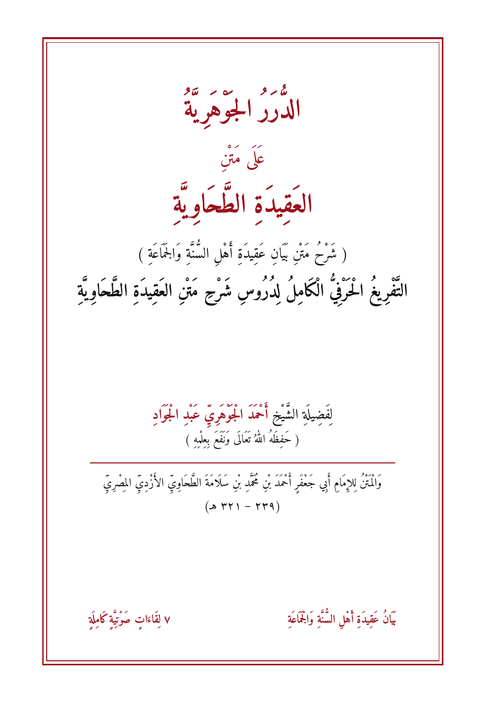
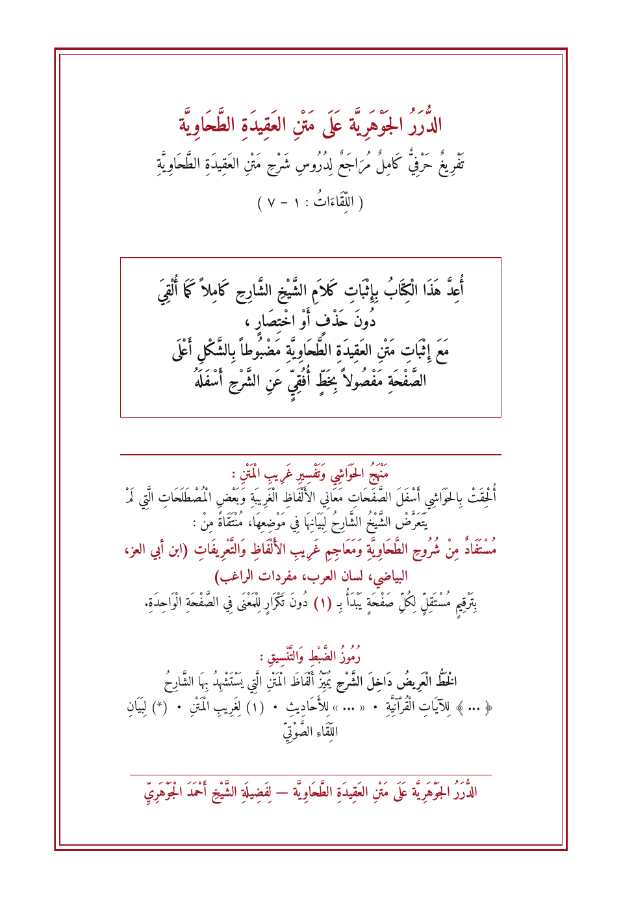
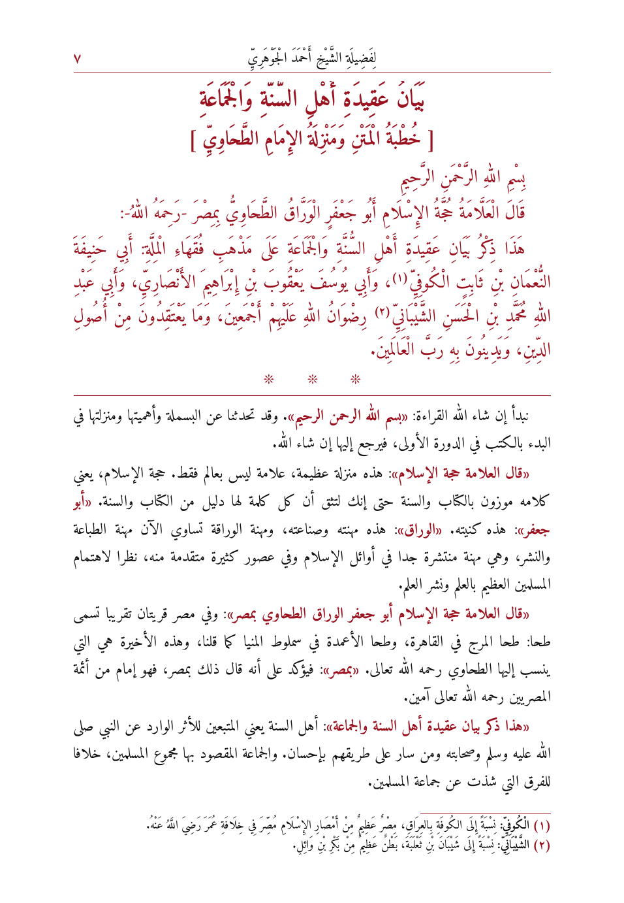
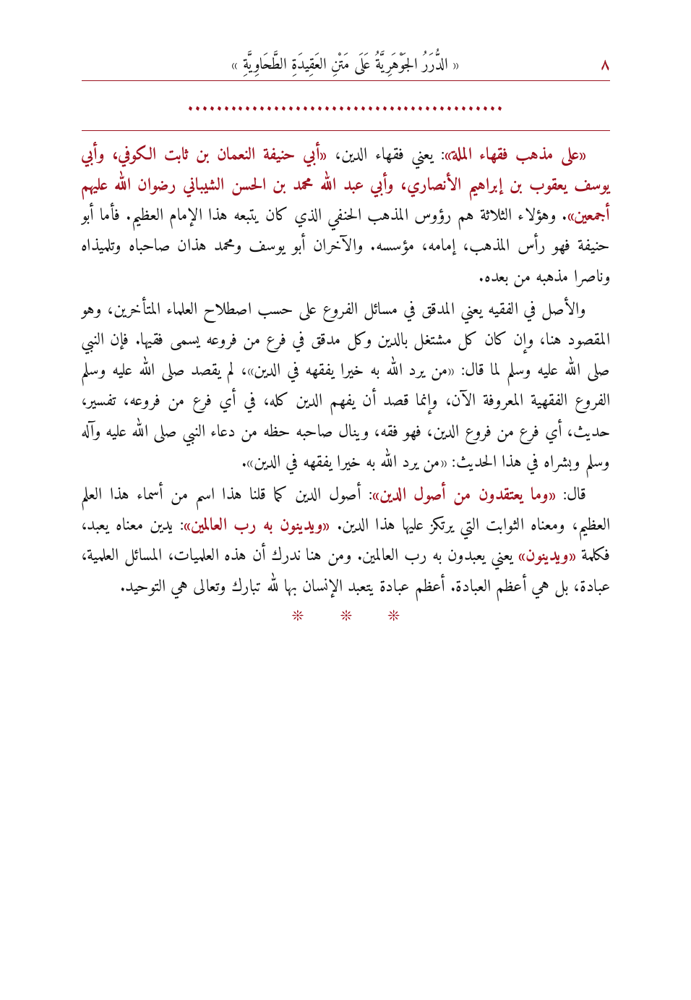
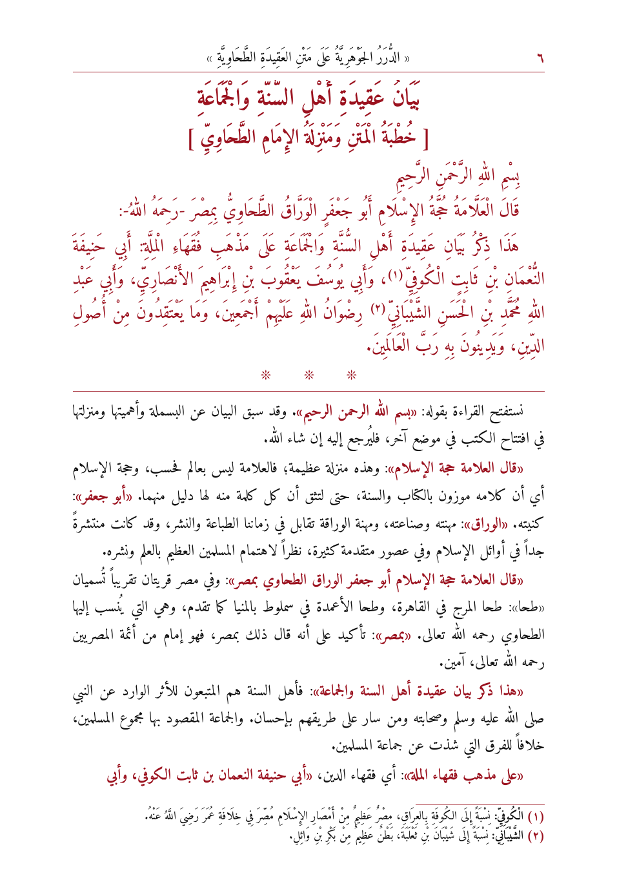
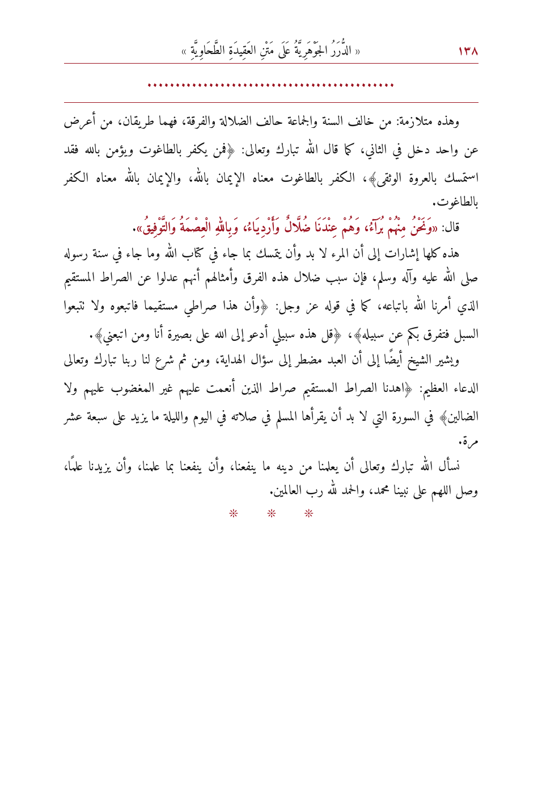
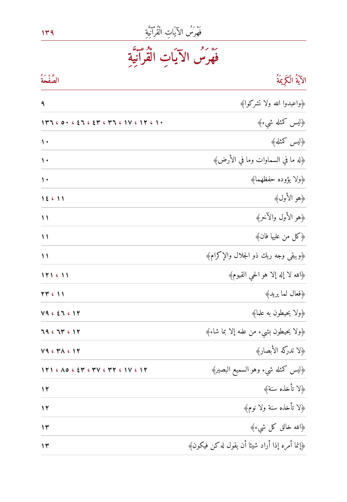
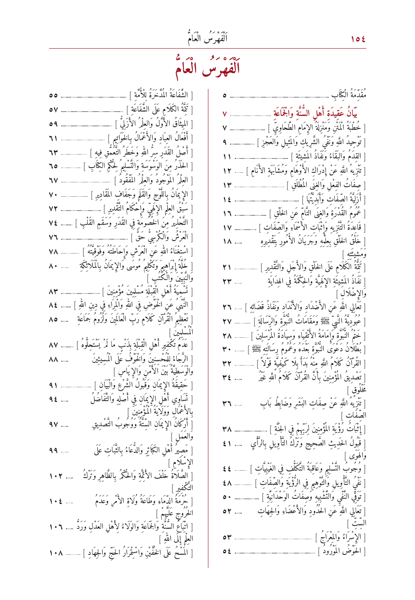
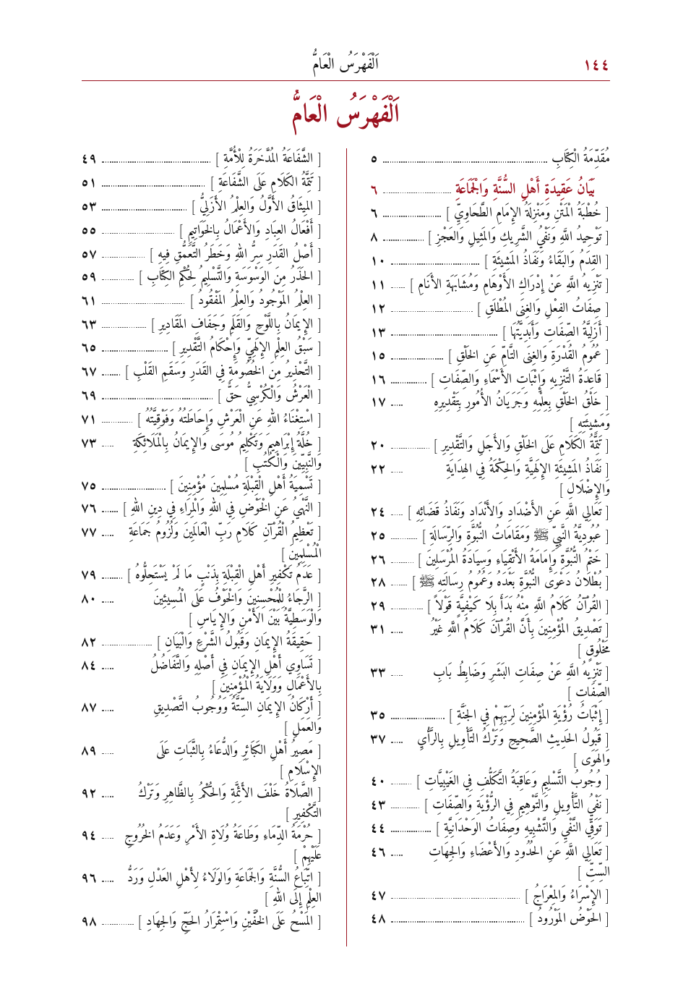

# التقرير الإحصائي والعلمي الشامل — «الدُّرَرُ الجَوْهَرِيَّةُ عَلَى مَتْنِ العَقِيدَةِ الطَّحَاوِيَّةِ»

## ١. نظرة عامة ونطاق العمل

يمثل هذا المشروع تفريغاً صوتياً مُحَقَّقاً، وإخراجاً مطبعياً متكاملاً على نمط كتب التراث الإسلامي، لشرح فضيلة الشيخ **أحمد الجوهري عبد الجواد** (حفظه الله تعالى) على متن **«العقيدة الطحاوية — بيان عقيدة أهل السنة والجماعة»** للإمام أبي جعفر الطحاوي (٢٣٩ – ٣٢١ هـ).

- **عدد المجالس الصوتية:** ٧ لقاءات كاملة.
- **إجمالي المدة الصوتية:** ٤١١ دقيقة (قرابة ٧ ساعات).
- **عدد المقاطع الصوتية المُراجَعة سمعياً:** **٦٢ مقطعاً صوتياً** (متوسط طول المقطع ~٧ دقائق).
- **عدد الوحدات العلمية المهيكلة:** **٦٩ وحدة** (مقدمة الكتاب + ٦٨ موضوعاً متسلسلاً يغطي متن الطحاوية كاملاً من البسملة حتى «وَبِاللَّهِ الْعِصْمَةُ وَالتَّوْفِيقُ»).
- **نسبة الاحتفاظ بالمتن الطحاوي:** **٩٨٫٤١٪** تطابقاً مع المتن المطبوع (`٢,١٦٦` كلمة متنية موزعة على الوحدات)، مع اعتماد الفروق اللفظية الثابتة التي قرأ بها الشيخ في الدرس (مثل إثبات `وَكُتُبِهِ` في موضع الإيمان بالملائكة والنبيين، وضبط خواتيم المقاطع كما قرأها الشارح).

---

## ٢. المقارنة الفنية والإحصائية بين الإصدارين

| البيان | النسخة الحرفية الكاملة | النسخة المحررة بالفصحى |
| :--- | :---: | :---: |
| **المنهج العلمي** | إثبات نص الدرس كما أُلقي حرفياً دون حذفٍ أو اختصار | تحريرٌ بالعربية الفصحى الميسرة خالٍ من العامية واللوازم الشفهية مع حفظ المعنى ١٠٠٪ |
| **عنوان الغلاف الداخلي (ص ٣)** | تفريغٌ حرفيٌّ كاملٌ مُراجَعٌ لدروسِ شرحِ متنِ العقيدةِ الطحاوية | تفريغٌ مُحَرَّرٌ لمحاضراتِ الشيخِ في شرحِ متنِ العقيدةِ الطحاوية |
| **عدد الصفحات (كلاسيكي & لونين)** | **١٥٥ صفحة** (تطابق تام بالملي) | **١٤٥ صفحة** (تطابق تام بالملي) |
| **إجمالي الكلمات (محتوى الوحدات)** | **٣١,٦٠٣ كلمة** (`١٠٠٫٠٪` احتفاظ من الخام) | **٢٨,١٧٩ كلمة** (`٨٩٫٢٪` — الفارق هو العامية والتحايا المحذوفة) |
| **الاستشهادات القرآنية المفهرسة** | **٢٦٣ موضعاً** (صفحات ١٣٩ – ١٥٣) | **٢٦٥ موضعاً** (صفحات ١٢٩ – ١٤٣) |
| **غريب المتن والحواشي السفلية** | **٣٦ حاشية** في **٢٧ وحدة** (ترقيم منفصل لكل صفحة يبدأ بـ `(١)`) | **٣٦ حاشية** في **٢٧ وحدة** (ترقيم منفصل لكل صفحة يبدأ بـ `(١)`) |
| **مقاس الصفحة (PDF & DOCX)** | `١٦٢ × ٢٣٤ ملم` (`9184 × 13266 twips`) | `١٦٢ × ٢٣٤ ملم` (`9184 × 13266 twips`) |
| **مستند Google Docs** | [النسخة الحرفية (٣٥,١٩٦ كلمة بالرؤوس)](https://docs.google.com/document/d/147BU4-ktK9Kkt9xrUYEkwJBTK3_2JNjUdJMdjFjOK-M/edit) | [النسخة المحررة (٣١,٧٧٧ كلمة بالرؤوس)](https://docs.google.com/document/d/1NoKaHFfIFj69x-MXYPU0YTjJndd8C2y9ABUHv6-61d0/edit) |

---

## ٣. نماذج مصوَّرة من الإخراج الفعلي (`١٥٠ DPI` من ملفات PDF)

### أ) الغلاف وصفحات الصدارة والمقدمة
| الغلاف الخارجي (ص ١) | صفحة العنوان (ص ٢) | صفحة المنهج والرموز — الحرفية (ص ٣) | صفحة المنهج — المحررة (ص ٣) |
| :---: | :---: | :---: | :---: |
|  |  |  |  |

### ب) المتن أعلى الصفحة والشرح والغريب في الأسفل ونقاط الاستمرار
| مقدمة الكتاب (ص ٥) | المتن + الشرح + حواشي الغريب (ص ٧) | نقاط الاستمرار في الشرح (ص ٨) | النسخة المحررة مع الغريب (ص ٦) |
| :---: | :---: | :---: | :---: |
|  |  |  |  |

### ج) الخاتمة وفهرس الآيات والفهرس العام
| خاتمة الشرح (ص ١٣٨) | فهرس الآيات القرآنية (ص ١٣٩) | الفهرس العام بعمودين (ص ١٥٤) | الفهرس العام — المحررة (ص ١٤٤) |
| :---: | :---: | :---: | :---: |
|  |  |  |  |

---

## ٤. نتائج فحوص الجودة البرمجية والطباعية (`100% PASS`)

1. **فحص الأمانة الحرفية (`scripts/verify_verbatim.py`):** تحقق رقمياً من تطابق الكلمات بنسبة **١٠٠.٠٪** (`31603 / 31603`) بين ملفات التفريغ المسموع الخام (`verbatim_raw`) وملفات الوحدات الهيكلية (`clean_lessons/L01.txt .. L07.txt`) دون حذف أو تبديل حرف واحد.
2. **فحص التحرير الفصيح (`scripts/verify_edited.py`):** تحقق من خلو النسخة المحررة (`edited_lessons/L01.txt .. L07.txt`) تماماً من الألفاظ الدارجة والمقاطع الصوتية المحشوة، ومن التطابق المطلق في خطوط المتن `MATN:` ورؤوس الوحدات، ومن حفظ جميع الآيات القرآنية (`100%` parity).
3. **فحص غريب الألفاظ (`book_engine/curate_glossary.py`):** تأكَّد من مطابقة أنماط الضبط الـ **٣٦** لعبارات المتن في ملفات `clean_lessons` حرفياً مع منع تكرار أي حاشية في الصفحة الواحدة وتجنب الحشو فيما بينه الشيخ أصلاً في الدرس.
4. **فحص OOXML لملفات Word (`.docx`):** فُحصت ملفات Word الأربعة عبر `lxml` لتأكيد:
   - مقاس الصفحة `9184 × 13266 twips` (`١٦٢ × ٢٣٤ ملم`).
   - وجود وسم الاتجاه من اليمين إلى اليسار (`w:bidi`) في كل فقرة (`1,654` موضعاً في الحرفية و`1,622` في المحررة).
   - سلامة جميع الروابط الداخلية للموضوعات في الفهرس العام (`anchors_ok=True`: `456` رابطاً في الحرفية، و`460` في المحررة).
   - خلوّ المستندات من العقد XML المكررة (`dup_rPr=0`, `dup_pPr=0`) ومن أي بقايا نصوص غير متصلة بالكتاب (`forbidden=[]`).
